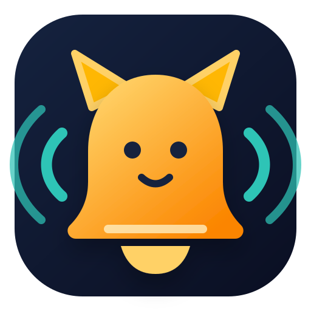

<p align="center">
  
</p>

<h1 align="center">Session Alarm for Antigravity</h1>

<p align="center">
  <strong>不必一直盯着屏幕等 AI 干活。</strong><br>
  Antigravity 需要你点确认、干完一轮或出错停下时，用本地声音提醒你；不用你管的时候安静不打扰。<br><br>
  <strong>Stop babysitting your coding agent.</strong><br>
  Plays a local sound when Antigravity needs your click, finishes a turn, or stops with an error — and stays quiet the rest of the time.
</p>

<p align="center">
  <a href="#中文说明">中文说明</a> · <a href="#english">English</a>
</p>

---

# 中文说明

## 这是干嘛的？

让 AI 自己跑任务时，你不用一直盯着窗口等它：
- **要你点按钮 / 审批了** → 响一声提醒你切回来看一眼
- **这轮活儿干完了** → 响一声告诉你回来看结果
- **中途报错停住了** → 响一声报错提示音
- **完全本地运行** → 不联网、不发消息、不上传对话或代码，同时保留对 Codex 与 Claude Code 的兼容。

> [!NOTE]
> **适用范围说明**：本仓库的 Antigravity 适配**专用于 Antigravity 桌面端 App（Desktop App）**；**Antigravity IDE 与 Antigravity CLI 暂未适配与测试（不保证兼容）**，因为各端的权限配置文件、目录结构与交互机制存在差异。
>
> 本项目基于 [`djfksjd/session-alarm`](https://github.com/djfksjd/session-alarm)（MIT 开源协议）针对 **Antigravity 桌面端 App** 做了深度适配，与 Google / Antigravity、OpenAI、Anthropic 无任何官方关联。

---

## 什么时候响？什么时候不响？

| 声音类型 | 什么时候触发 | 默认声音 |
|---|---|---|
| **`attention`（等你操作）** | 弹出选择题、需要你点审阅 `Proceed`、或审批弹窗停留超过 **5 秒** | `cat`（猫） |
| **`complete`（干完了）** | 主对话这一轮正常跑完（支持中文总结，结尾带问句也不会误响成审批） | `rooster`（公鸡） |
| **`error`（出错了）** | 会话异常中断，或回复末尾出现中 / 英 / 韩文报错提示 | `crow`（乌鸦） |
| **`session_end`（会话关闭）** | Antigravity 下默认静音，不打扰 | `owl`（猫头鹰） |

### 为什么叫「5 秒防扑空」？
1. **看得到窗再叫你**：命令、跨对话读文件、工作区外改文件、MCP 工具等，插件会先等 **5 秒**。如果 Antigravity 自己放行了，或者你刚好在屏幕前 5 秒内点完允许、操作顺利完成，闹钟会自动取消——**彻底静音不吵人**；只有弹窗真的卡在屏幕上超过 5 秒等你处理时，才响起提醒，你一抬头弹窗稳稳就在那儿。
2. **明确要你选的立刻响**：选择题（`ask_question`）和请求审阅文档（`Proceed`）会在后台立刻响，同时不拖慢弹窗弹出来的速度。
3. **这些情况全都不误响**：
   - 后台子代理（subagent）悄悄干活、后台任务还没跑完、或者你自己手动点取消；
   - 在当前工作区或当前对话自己的目录里正常读写文件；
   - 你在 Antigravity 设置里选了**极速（Turbo）模式**，或把某个命令 / 路径 / MCP 加进了「**总是允许**」白名单（插件会实时同步你的设置）。

---

## 3 步安装与常用命令

### 第 1 步：放进 Antigravity 插件目录
可以直接用 `git clone` 一键拉取到 Antigravity 的全局插件目录（或下载 Release 压缩包解压/软链接到同路径），文件夹名字保持 `session-alarm`：

**Windows (PowerShell)：**
```powershell
git clone https://github.com/nthtre/session-alarm-antigravity.git "$env:USERPROFILE\.gemini\config\plugins\session-alarm"
```

**macOS / Linux：**
```bash
git clone https://github.com/nthtre/session-alarm-antigravity.git "$HOME/.gemini/config/plugins/session-alarm"
```

然后在 Antigravity 插件面板里开启 **Session Alarm**，重启一轮新对话就会自动生效。

### 第 2 步：确认运行环境
- **Node.js**（用来跑钩子脚本 `scripts/agy_hook.mjs`）
- **Python 3.9+**（Windows 会自动扫描 `%APPDATA%\uv\python\cpython-*\python.exe`，再回退系统 `py -3` / `python`；macOS 用 `afplay`，Linux 用 `paplay`/`aplay`/`ffplay`，Windows 用自带 `winsound`）

### 第 3 步：日常顺手命令

**Windows (PowerShell)：**
```powershell
$CLI = "$env:USERPROFILE\.gemini\config\plugins\session-alarm\scripts\session_alarm.py"
# 也可使用 python 或 uv 管理的 python.exe

py -3 $CLI status                    # 看当前用了什么声音和音量
py -3 $CLI catalog                   # 看全部 12 种内置音效和你导入的音效
py -3 $CLI preview cat --volume 60   # 试听某一个声音
py -3 $CLI test all                  # 把提示音依次试播一遍
```

**macOS / Linux：**
```bash
CLI="$HOME/.gemini/config/plugins/session-alarm/scripts/session_alarm.py"
python3 "$CLI" status
python3 "$CLI" test all
```

### 换成你自己的提示音（可选）
你可以把**自己制作或已获授权的本地 PCM WAV**（不超过 30 秒 / 32 MB）导进来，只存在你本机，不会改动插件仓库：

```bash
python3 "$CLI" custom add "/path/to/your-sound.wav" --name "My Alert" --id my-alert --preview
python3 "$CLI" configure --attention custom:my-alert --volume 50 --quiet-hours 23:00-07:30
```

> [!TIP]
> 改声音或音量请用上面的 `configure` 命令，不要手动去改 `config.json`，命令会自动校验并生成对应音量的音频缓存。

---

<details>
<summary>查看内置的 12 种真实动物音效（均为 CC0 无版权限制）</summary>

| 类别 | ID 与动物 |
|---|---|
| 宠物 | `cat`（猫）、`dog`（狗） |
| 农场动物 | `cow`（牛）、`horse`（马）、`pig`（猪）、`goat`（山羊）、`sheep`（绵羊）、`rooster`（公鸡） |
| 鸟类 | `owl`（猫头鹰）、`crow`（乌鸦） |
| 小型生物 | `frog`（青蛙）、`cricket`（蟋蟀） |

</details>

<details>
<summary>进阶环境变量与维护排查</summary>

- 延迟闹钟默认全部为 `5000` 毫秒（5 秒），可用正整数毫秒环境变量单独微调：
  - `SESSION_ALARM_DELAY_READ_MS`（读文件）
  - `SESSION_ALARM_DELAY_WRITE_MS`（工作区外写文件）
  - `SESSION_ALARM_DELAY_COMMAND_MS`（待审查命令）
  - `SESSION_ALARM_DELAY_MCP_MS`（MCP 工具）
- `SESSION_ALARM_SKIP_MCP_PREFIXES`：可选，逗号分隔的受信任 MCP 前缀（默认不跳过；例如设为 `mcp_myserver_` 可跳过对应工具的延迟提醒）。
- 校验内置 12 个音频完整性：`python3 scripts/verify_builtin_sounds.py`
- 详细架构、排查流程与静音测试说明见 [MAINTENANCE.md](MAINTENANCE.md)。

</details>

## 隐私与开源许可

- **纯本地、零联网**：不收集、不上传任何对话内容或代码，状态与最近 200 条触发元信息只保存在本机 `%APPDATA%\session-alarm\`（Windows）或 `~/.config/session-alarm/`（macOS/Linux），详见 [PRIVACY.md](PRIVACY.md)。
- **MIT 协议**：代码与文档采用 [MIT License](LICENSE)（保留原作者 Danny 版权）。
- **音频溯源**：12 个内置动物录音均核验为 CC0 1.0 Universal，详见 [SOUND_LICENSE.md](SOUND_LICENSE.md)、[THIRD_PARTY_NOTICES.md](THIRD_PARTY_NOTICES.md) 与 [assets/sounds/sources.json](assets/sounds/sources.json)。

## 已知边界：可能的误报与漏报（及原因）

Antigravity 目前没有暴露「审批框真正弹出」的原生钩子事件，插件是通过**读设置白名单 + 5 秒完成计时**来推断的，因此有以下几种边界情况：

### 1. 可能会多响（误报）的情况
- **点了「在此会话中始终允许」后，执行超过 5 秒的沙箱外命令或慢速 MCP**
  - **原因**：会话级授权只存在 Antigravity 的内存里，不会写进硬盘上的 `config.json` / `projects/*.json`，插件看不见；命令跑完前 `PostToolUse` 还没触发，满 5 秒就会响一下。
  - **解决**：常用且耗时的命令点「**是，且始终允许**」进永久白名单即可彻底静音。
- **没弹窗但远程联网超 5 秒的 MCP 工具**
  - **原因**：联网查询类 MCP 如果服务端响应慢（超过 5 秒），钩子分不清是在等网络还是在等你点弹窗，满 5 秒也会响。
  - **解决**：可把环境变量 `SESSION_ALARM_DELAY_MCP_MS` 调大（如 `10000`），或在 `SESSION_ALARM_SKIP_MCP_PREFIXES` 中加入该前缀，或把常用 MCP 加入永久白名单。
- **工具被其他插件/模式静默拦截（如计划模式禁止修改）**
  - **原因**：拦截发生在后，被拒绝的工具不会触发 `PostToolUse` 取消闹钟；如果当时这一轮还没结束（未触发 `Stop`），5 秒后闹钟就会响。
- **回复结尾撞上极少数报错句式**
  - **原因**：`Stop` 阶段会检查回复最后 700 字符来判断是 `complete` 还是 `error`。插件已剥离代码块/行内反引号并过滤了「已修复、无报错、0 个失败、如果/假如」等排除词，但极个别自然语言总结仍可能撞中报错句式，把完成音播成报错音。

### 2. 可能会不响（漏报）的情况
- **弹窗在 5 秒内就被你点掉或处理完**
  - **原因**：这是 5 秒防扑空机制的预期行为——你已经在看屏幕处理时不会打扰你；如果希望更快提醒，可调小 `SESSION_ALARM_DELAY_*_MS`（如 `2500`）。
- **聊天框左下角临时切换过单对话「本地权限」**
  - **原因**：比如全局设了极速（Turbo），你只在当前这一个对话左下角临时切成了「请求审查」——这个临时开关同样只保存在内存里、不写配置文件，插件仍以为是 Turbo 模式而保持静音。
  - **解决**：需要切换模式时，在 Antigravity 全局或项目设置页面修改即可 100% 实时同步。
- **命中手动配置的 `SESSION_ALARM_SKIP_MCP_PREFIXES` 前缀的 MCP 真弹了审批窗**
  - **原因**：如果你手动把某个 MCP 前缀加进了 `SESSION_ALARM_SKIP_MCP_PREFIXES`，但在 Antigravity 里它还没获得永久放行、确实弹出了审批框，它也不会响。
  - **解决**：从 `SESSION_ALARM_SKIP_MCP_PREFIXES` 移除该前缀（或置空），改为靠 Antigravity 的「总是允许」白名单来静音。
- **1.5 秒内连续触发同类提示音**
  - **原因**：`core.py` 内置了 1.5 秒去重窗口，短时间连续多个同类事件（如同时弹出两个需要审批的动作）只响一次，避免音效叠音吵耳。
- **处于免打扰时段或插件被停用**
  - **原因**：配置了 `quiet_hours` 或关闭了总开关；可运行 `session_alarm.py status` 确认当前状态。
- **Antigravity 内置的联网访问与浏览器操控工具（不包含在提醒范围内）**
  - **原因**：插件目前依赖 `PreToolUse` 启动 5 秒计时 + `PostToolUse` 取消计时来推断审批弹窗；而内置联网请求与浏览器操控（尤其是多步执行的浏览器子代理）正常执行本身就经常超过 5 秒且期间不触发 `PostToolUse`，如果纳入监听极易在自动放行时大量误报，因此刻意未加入匹配（通过 `mcp_*` 调用的外部浏览器/联网 MCP 工具或通过 `run_command` 执行的联网命令仍按各自规则触发）。

---

# English

## What does it do?

When Antigravity is working on a task, you don't have to keep staring at the chat window:
- **Needs your click / approval** → plays an attention sound
- **Finished its turn** → plays a completion chime
- **Stopped with an error** → plays an error alert
- **100% local & offline** → no accounts, no network requests, no telemetry. Also stays compatible with Codex and Claude Code.

> [!NOTE]
> **Compatibility Note**: The Antigravity adaptation in this repository is built **specifically for the Antigravity Desktop App**; **Antigravity IDE and Antigravity CLI are not adapted or tested (compatibility not guaranteed)**, as their permission configs, directory layouts, and interactions differ.
>
> Adapted for **Antigravity Desktop App** from [`djfksjd/session-alarm`](https://github.com/djfksjd/session-alarm) (MIT License). Independent open-source project, not affiliated with or endorsed by Google / Antigravity, OpenAI, or Anthropic.

---

## When does it ring vs. stay quiet?

| Event | When it triggers | Default sound |
|---|---|---|
| **`attention`** | Multiple-choice prompt, document review (`Proceed`), or an approval popup waiting **> 5 seconds** | `cat` |
| **`complete`** | Main conversation turn finishes normally (even if the summary ends with a question) | `rooster` |
| **`error`** | Turn terminates with an error, or ends with an English / Chinese / Korean error statement | `crow` |
| **`session_end`** | Silenced by default in Antigravity | `owl` |

### How the "5-second smart wait" avoids false alarms
1. **Popup-first timing**: Approval-gated commands, outside-workspace edits, cross-conversation reads, and MCP tools arm a **5-second timer** first. If Antigravity auto-allows the call or you approve it right away, `PostToolUse` cancels the timer silently. Only when a popup is genuinely sitting there waiting for you after 5 seconds does the alarm ring — so when you look over, the popup is already on screen.
2. **Instant background alerts**: Multiple-choice questions (`ask_question`) and reviewable docs (`RequestFeedback`) play immediately via a detached background worker without slowing down popup rendering.
3. **What stays completely quiet**:
   - Subagent runs, turns still waiting on background tasks, or manual cancellation (`USER_CANCELED`);
   - Normal reads/writes inside your workspace or the current conversation's own artifact folder;
   - **Turbo mode** and anything matched by your Antigravity **"Always Allow"** rules (`config.json` & `projects/*.json` are read live in read-only mode).

---

## 3-Step Setup & Everyday Commands

### Step 1: Install into Antigravity's plugins folder
Clone this repository directly into Antigravity's global plugins directory as `session-alarm` (or download a Release archive and copy/symlink it there):

**Windows (PowerShell):**
```powershell
git clone https://github.com/nthtre/session-alarm-antigravity.git "$env:USERPROFILE\.gemini\config\plugins\session-alarm"
```

**macOS / Linux:**
```bash
git clone https://github.com/nthtre/session-alarm-antigravity.git "$HOME/.gemini/config/plugins/session-alarm"
```

Enable **Session Alarm** in Antigravity and start a new turn.

### Step 2: Prerequisites
- **Node.js** (runs `scripts/agy_hook.mjs`)
- **Python 3.9+** (on Windows, automatically scans `%APPDATA%\uv\python\cpython-*\python.exe` before falling back to `py -3` / `python`; uses built-in `winsound` on Windows, `afplay` on macOS, and `paplay` / `aplay` / `ffplay` on Linux)

### Step 3: Useful CLI commands

**Windows (PowerShell):**
```powershell
$CLI = "$env:USERPROFILE\.gemini\config\plugins\session-alarm\scripts\session_alarm.py"
# python or a uv-managed python.exe also works

py -3 $CLI status                    # Check active sounds and volume
py -3 $CLI catalog                   # List all 12 built-in + custom sounds
py -3 $CLI preview cat --volume 60   # Preview one sound
py -3 $CLI test all                  # Test every event sound
```

**macOS / Linux:**
```bash
CLI="$HOME/.gemini/config/plugins/session-alarm/scripts/session_alarm.py"
python3 "$CLI" status
python3 "$CLI" test all
```

### Use your own WAV sounds (optional)
Import any local PCM WAV file you own or have rights to use (up to 30s / 32 MB) into your private user config without touching the repo:

```bash
python3 "$CLI" custom add "/path/to/your-sound.wav" --name "My Alert" --id my-alert --preview
python3 "$CLI" configure --attention custom:my-alert --volume 50 --quiet-hours 23:00-07:30
```

> [!TIP]
> Always update settings through `configure` rather than editing `config.json` by hand so volume-scaled WAV caches are generated properly.

---

<details>
<summary>12 built-in real-animal sounds (CC0 1.0 Universal)</summary>

| Group | IDs |
|---|---|
| Pets | `cat`, `dog` |
| Farm | `cow`, `horse`, `pig`, `goat`, `sheep`, `rooster` |
| Birds | `owl`, `crow` |
| Small creatures | `frog`, `cricket` |

</details>

<details>
<summary>Optional environment variables & troubleshooting</summary>

- All delayed approval thresholds default to `5000` ms (5 seconds) and can be overridden with positive integer milliseconds:
  - `SESSION_ALARM_DELAY_READ_MS` (`read_file` / `view_file`)
  - `SESSION_ALARM_DELAY_WRITE_MS` (outside-workspace writes)
  - `SESSION_ALARM_DELAY_COMMAND_MS` (approval-gated `run_command`)
  - `SESSION_ALARM_DELAY_MCP_MS` (`mcp_*` / `call_mcp_tool`)
- `SESSION_ALARM_SKIP_MCP_PREFIXES`: optional comma-separated trusted MCP prefixes to skip (empty by default; e.g., `mcp_myserver_`).
- Verify the 12 bundled CC0 WAV files offline: `python3 scripts/verify_builtin_sounds.py`
- Full technical reference & isolated hook testing guide: [MAINTENANCE.md](MAINTENANCE.md).

</details>

## Privacy & Licensing

- **Local only**: Never stores or transmits prompts or file contents. Config, local WAV cache, and the latest 200 hook metadata lines live strictly in `%APPDATA%\session-alarm\` (Windows) or `~/.config/session-alarm/` (macOS/Linux). See [PRIVACY.md](PRIVACY.md).
- **MIT License**: Code and docs are licensed under [MIT License](LICENSE) (Copyright (c) 2026 Danny).
- **Sound provenance**: All 12 bundled animal recordings are CC0 1.0 Universal — see [SOUND_LICENSE.md](SOUND_LICENSE.md), [THIRD_PARTY_NOTICES.md](THIRD_PARTY_NOTICES.md), and [assets/sounds/sources.json](assets/sounds/sources.json).

## Known Limitations: Possible False Alarms & Missed Alerts (and Why)

Because Antigravity does not currently provide a native hook event that fires only when a permission dialog is rendered, the plugin infers popups from on-disk settings + a 5-second completion timer. That leads to a few known edge cases:

### 1. Possible False Alarms
- **Long (> 5s) unsandboxed commands or slow MCPs approved with "Always allow for this session"**
  - **Why**: Session-scoped grants live only in Antigravity's memory and are not written to `config.json` or `projects/*.json`. Until the command finishes and triggers `PostToolUse`, the 5-second timer will still fire.
  - **Fix**: Use permanent **"Always allow"** for frequent long-running commands.
- **Slow remote/network MCP calls taking > 5s without a popup**
  - **Why**: Without a native dialog event, the plugin cannot distinguish a slow network response (> 5s) from a waiting approval prompt.
  - **Fix**: Increase `SESSION_ALARM_DELAY_MCP_MS` (e.g., `10000`), add trusted prefixes to `SESSION_ALARM_SKIP_MCP_PREFIXES`, or add the MCP tool to permanent allow grants.
- **Tool calls silently blocked by another hook or hardcoded guard**
  - **Why**: Rejected calls do not trigger `PostToolUse` to cancel the timer; if the turn does not `Stop` within 5 seconds, the timer fires once.
- **Rare error-like phrasing at the end of a normal summary**
  - **Why**: `Stop` scans the last 700 characters of the final reply. Although code blocks, inline backticks, and negation/hypothetical phrases (e.g., "fixed", "0 failed", "if ...") are filtered out, rare phrasing can still match an error pattern and play `error` instead of `complete`.

### 2. Possible Missed Alerts
- **Popups handled within 5 seconds**
  - **Why**: By design, if you are already watching the screen and respond within 5 seconds, `PostToolUse` cancels the alert silently. Lower `SESSION_ALARM_DELAY_*_MS` (e.g., `2500`) if you want faster alerts.
- **Per-chat temporary permission switch in the bottom-left UI**
  - **Why**: Switching a single chat from global Turbo to Review mode is stored only in Antigravity's in-memory session state, so hooks still see global Turbo and stay silent.
  - **Fix**: Change permission presets in Antigravity's global or project settings for 100% live sync.
- **An MCP prefix manually added to `SESSION_ALARM_SKIP_MCP_PREFIXES` actually prompts**
  - **Why**: Any prefix you manually exclude via `SESSION_ALARM_SKIP_MCP_PREFIXES` skips the timer even if Antigravity has not permanently allowed it yet.
  - **Fix**: Remove that prefix from `SESSION_ALARM_SKIP_MCP_PREFIXES` (or unset it) and rely on Antigravity's "Always Allow" grants instead.
- **Back-to-back identical alerts within 1.5 seconds**
  - **Why**: `core.py` enforces a 1.5-second deduplication window per `(event, source)` so simultaneous alerts do not overlap noisily.
- **Quiet hours or disabled state**
  - **Why**: `quiet_hours` is active or `enabled` is `false` in your local config. Run `session_alarm.py status` to check.
- **Antigravity built-in network access and browser-control tools (intentionally excluded)**
  - **Why**: Without a native "approval dialog opened" hook event, the plugin relies on a 5-second `PreToolUse` → `PostToolUse` timer. Built-in network requests and browser automation (especially multi-step browser subagents) routinely take longer than 5 seconds even when auto-allowed, which would trigger frequent false alarms. They are therefore intentionally left unmatched (browser/network tools invoked via `mcp_*` or terminal `run_command` still follow their respective rules).
